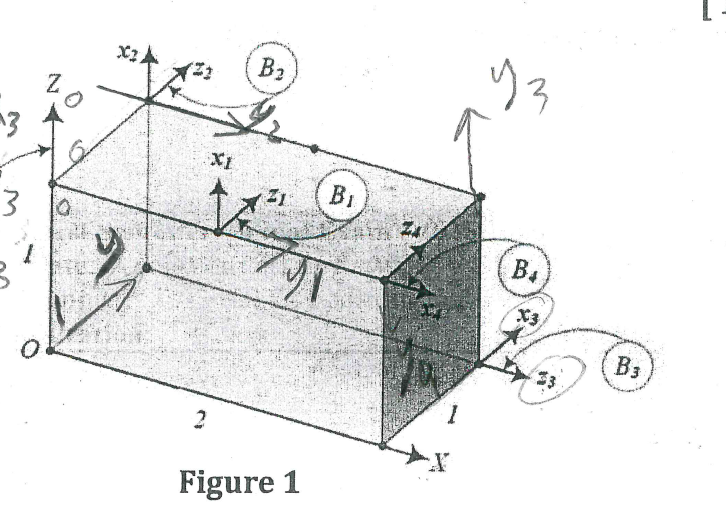

git remote add origin git@github.com:andrew-tanas/ITIVersionControlLab2.git
git branch -M main
git add .
git commit -m "creating main branch"
git push -u origin main
git branch dev
git branch test
git switch dev
git switch test
git switch dev
git add .
git commit -m "adding dev file"
git switch test
git add .
git commit -m "adding test file"
git switch main
git merge dev
git merge test
git log
git push -u origin main
git switch test
git push -u origin test
git log
git switch dev
git push -u origin dev
git branch -d test
git switch main
git push origin --delete test
git switch dev
git stash
git switch main
git switch dev
git stash pop
git commit -am "create name"
git push -u origin dev
git switch main
git tag -a v1.7 -m "version 1.7"
git push origin v1.7
git tag -d v1.7
git push origin --delete v1.7
git switch dev
git add .
git commit -m "adding readme file"
git switch main
git merge dev
git switch dev
git push -u origin dev
git switch main
git push -u origin main
git switch dev

